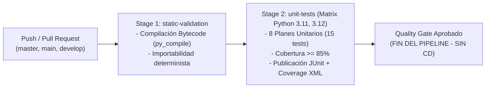
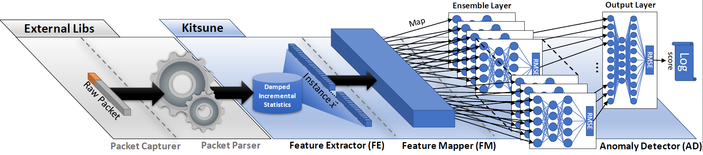

# Kitsune-py: Online Network Intrusion Detection System & CI/CD Testing Pipeline

[](https://github.com/NativelogXD/repositorio-pipeline-kitsune/actions/workflows/ci-unit-tests.yml)
[](tests/unit)
[](tests/unit)
[](requirements.txt)
[](docs/)

> **Proyecto:** Kitsune-py (Online NIDS basado en un ensamble de autoencoders)  
> **Asignatura:** Ingeniería de Software III  
> **Alcance del Pipeline:** Análisis estático, suite consolidada de **15 pruebas unitarias deterministas** y reporte de cobertura con Quality Gate en CI (`>= 85%`, sin despliegue continuo CD).

---

## Tabla de Contenidos

1. [Estructura del Repositorio](#estructura-del-repositorio)
2. [Requisitos Previos](#requisitos-previos)
3. [Instalación Paso a Paso](#instalación-paso-a-paso)
4. [Ejecución del Proyecto](#ejecución-del-proyecto)
5. [Ejecución de las 15 Pruebas Unitarias y Cobertura](#ejecución-de-las-15-pruebas-unitarias-y-cobertura)
6. [Resumen de Cobertura y Matriz de las 15 Pruebas](#resumen-de-cobertura-y-matriz-de-las-15-pruebas)
7. [Arquitectura del Pipeline CI en GitHub Actions](#arquitectura-del-pipeline-ci-en-github-actions)
8. [Configuración de los Parámetros del Pipeline](#configuración-de-los-parámetros-del-pipeline)
9. [Guía de Evaluación para el Docente (Prueba de Fallo Intencional)](#guía-de-evaluación-para-el-docente-prueba-de-fallo-intencional)
10. [Solución de Problemas Frecuentes](#solución-de-problemas-frecuentes)
11. [Descripción Científica Original de Kitsune](#descripción-científica-original-de-kitsune)
12. [Licencia y Citación](#licencia-y-citación)

---

## Estructura del Repositorio

```text
repositorio-pipeline-kitsune/
├── .github/
│   └── workflows/
│       └── ci-unit-tests.yml        # Pipeline CI en GitHub Actions (Matrix Python 3.11 / 3.12)
├── KitNET/                          # Ensamble de autoencoders y clustering
│   ├── __init__.py
│   ├── KitNET.py                    # Orquestador del ensamble
│   ├── corClust.py                  # Clustering incremental de correlación
│   ├── dA.py                        # Denoising Autoencoder
│   ├── utils.py                     # Activaciones, distribuciones y buffer circular
│   └── LICENSE.txt
├── docs/                            # Documentación académica y técnica completa (IEEE 829)
│   ├── 01_ANALISIS_PROYECTO_KITSUNE.md
│   ├── 02_PLAN_GENERAL_PRUEBAS_Y_PIPELINE_CI.md
│   ├── 03_PLANES_ESPECIFICOS_PRUEBAS_UNITARIAS.md
│   ├── kitsune-pruebas.md           # Informe consolidado unificado
│   ├── kitsune-pruebas.docx         # Documento Word formateado para entrega
│   └── planes_unitarios/            # Fichas individuales PU-01 a PU-08
│       ├── PU_01_KitNET_utils.md
│       ├── PU_02_KitNET_dA.md
│       ├── PU_03_KitNET_corClust.md
│       ├── PU_04_KitNET_Orquestador.md
│       ├── PU_05_AfterImage.md
│       ├── PU_06_netStat.md
│       ├── PU_07_FeatureExtractor.md
│       └── PU_08_Kitsune_Facade.md
├── tests/                           # Suite de pruebas unitarias (15 casos totales)
│   ├── conftest.py                  # Fixtures deterministas y generador de tráfico TSV
│   └── unit/                        # 8 módulos de prueba (PU-01 a PU-08)
│       ├── test_afterimage.py       # 2 pruebas (UT-AI-001 a UT-AI-002)
│       ├── test_corclust.py         # 2 pruebas (UT-CC-001 a UT-CC-002)
│       ├── test_da.py               # 2 pruebas (UT-DA-001 a UT-DA-002)
│       ├── test_feature_extractor.py# 2 pruebas (UT-FE-001 a UT-FE-002)
│       ├── test_kitnet.py           # 2 pruebas (UT-KN-001 a UT-KN-002)
│       ├── test_kitsune.py          # 1 prueba  (UT-KIT-001)
│       ├── test_netstat.py          # 2 pruebas (UT-NS-001 a UT-NS-002)
│       └── test_utils.py            # 2 pruebas (UT-UTILS-001 a UT-UTILS-002)
├── AfterImage.py                    # Motor estadístico incremental amortiguado 1D/2D
├── AfterImage_extrapolate.pyx       # Extensión experimental Cython para extrapolación
├── FeatureExtractor.py              # Extractor de paquetes (TSV / Scapy)
├── Kitsune.py                       # Fachada principal del detector NIDS
├── netStat.py                       # Gestor de estadísticas multiperspectiva (100 features)
├── example.py                       # Demostración del flujo completo con Mirai botnet
├── mirai.zip                        # Captura PCAP de ejemplo para ejecución del proyecto
├── pytest.ini                       # Configuración de pytest (testpaths = tests/unit)
├── requirements.txt                 # Dependencias de ejecución del proyecto
├── requirements-dev.txt             # Dependencias de desarrollo y pruebas unitarias
├── setup.py                         # Compilación opcional de extensión Cython
├── Kitsune paper.pdf                # Paper científico original (NDSS 2018)
├── Kitsune_fig.png                  # Diagrama arquitectónico del sistema
└── LICENSE                          # Licencia MIT
```

---

## Requisitos Previos

Antes de iniciar, asegúrate de contar con:

1. **Python 3.11 o superior** (verificado en CI sobre `3.11` y `3.12`, y en entorno local sobre `3.14`).
   * Comprueba tu versión con:
     ```bash
     python --version
     ```
2. **Git** para clonar el repositorio.
3. **Wireshark / `tshark` *(Opcional)*:**
   * `FeatureExtractor.py` busca `C:\Program Files\Wireshark\tshark.exe` (Windows) o `tshark` en `PATH` (Linux/macOS) para convertir `.pcap` a `.tsv` a alta velocidad.
   * Si no tienes Wireshark instalado, **el proyecto funciona igual** utilizando automáticamente el motor alternativo **Scapy** (incluido en `requirements.txt`), aunque el parseo de capturas grandes será más lento.

---

## Instalación Paso a Paso

### Paso 1: Clonar el repositorio y entrar a la carpeta del proyecto

```bash
git clone https://github.com/NativelogXD/repositorio-pipeline-kitsune.git
cd repositorio-pipeline-kitsune
```

*(La rama `main` ya contiene la versión consolidada final del aplicativo, las 15 pruebas unitarias, la documentación IEEE 829 y el pipeline CI).*

### Paso 2: Crear y activar un entorno virtual (`.venv`)

Es recomendable aislar las dependencias en un entorno virtual local (`.venv/` ya está incluido en `.gitignore`):

* **En Windows (PowerShell):**
  ```powershell
  python -m venv .venv
  .\.venv\Scripts\Activate.ps1
  ```
  > **Nota:** Si PowerShell bloquea la ejecución de scripts, habilita scripts locales para tu usuario con:
  > `Set-ExecutionPolicy -ExecutionPolicy RemoteSigned -Scope CurrentUser`
  > (o bien utiliza CMD con `.\.venv\Scripts\activate.bat`).

* **En Linux / macOS:**
  ```bash
  python3 -m venv .venv
  source .venv/bin/activate
  ```

### Paso 3: Instalar las dependencias

Actualizar `pip` e instalar el conjunto que necesites:

* **Opción A — Instalación completa (Proyecto + Suite de Pruebas Unitarias) *(Recomendada)*:**
  ```bash
  python -m pip install --upgrade pip
  pip install -r requirements-dev.txt
  ```
  *(Instala `numpy`, `scipy`, `scapy`, `cython`, `matplotlib`, `pytest`, `pytest-cov` y `coverage`).*

* **Opción B — Solo dependencias de ejecución del proyecto:**
  ```bash
  python -m pip install --upgrade pip
  pip install -r requirements.txt
  ```

---

## Ejecución del Proyecto

### 1. Ejecutar la demostración completa (`example.py`)

El repositorio incluye el archivo comprimido [`mirai.zip`](mirai.zip) con tráfico de red real de la botnet Mirai. Para ejecutar el detector de anomalías de extremo a extremo:

```bash
python example.py
```

**¿Qué ocurre al ejecutar `example.py`?**
1. Descomprime automáticamente `mirai.zip` generando `mirai.pcap` en la raíz (ignorado por `.gitignore`).
2. Inicializa `Kitsune(path="mirai.pcap", limit=np.inf, maxAE=10, FMgrace=5000, ADgrace=50000)`.
3. Procesa los paquetes uno a uno mediante `K.proc_next_packet()`:
   * Primeros `5,000` paquetes: aprendizaje del mapeo de características (`corClust`).
   * Siguientes `50,000` paquetes: entrenamiento del ensamble de autoencoders (`KitNET`).
   * Resto de paquetes: cálculo del puntaje de anomalía (RMSE).
4. Ajusta una distribución log-normal (`scipy.stats.norm.logsf`) sobre los RMSE benignos y muestra una gráfica interactiva con `matplotlib`.

> [!NOTE]
> Si no tienes `tshark` (Wireshark) instalado, `FeatureExtractor.py` imprimirá `tshark not found. Trying scapy...` y procesará `mirai.pcap` con Scapy, lo cual puede tardar varios minutos debido al volumen de paquetes de la captura.

### 2. Uso básico en tus propios scripts o capturas

```python
import numpy as np
from Kitsune import Kitsune

# Parámetros de Kitsune
path = "mi_captura.pcap"   # Acepta .pcap, .pcapng o .tsv
packet_limit = np.inf      # Número máximo de paquetes a procesar
maxAE = 10                 # Tamaño máximo de cada autoencoder en el ensamble
FMgrace = 5000             # Paquetes para aprender el mapeo de características
ADgrace = 50000            # Paquetes para entrenar los autoencoders

K = Kitsune(path, packet_limit, maxAE, FMgrace, ADgrace)

while True:
    rmse = K.proc_next_packet()
    if rmse == -1:         # Centinela de fin de archivo (EOF)
        break
    print(f"Anomaly RMSE: {rmse}")
```

---

## Ejecución de las 15 Pruebas Unitarias y Cobertura

Asegúrate de tener el entorno virtual `.venv` activo y haber instalado `requirements-dev.txt`.

### 1. Verificación estática (Equivalente al `Stage 1` del Pipeline CI)

```bash
python -m py_compile Kitsune.py FeatureExtractor.py netStat.py AfterImage.py KitNET/__init__.py KitNET/utils.py KitNET/dA.py KitNET/corClust.py KitNET/KitNET.py
python -c "import Kitsune, FeatureExtractor, netStat, AfterImage; from KitNET import KitNET, corClust, dA, utils; print('Static import check OK')"
```

### 2. Ejecutar las 15 pruebas unitarias completas

```bash
python -m pytest tests/unit -v
```

*(Deberías observar `collected 15 items` y `15 passed`).*

### 3. Ejecutar las 15 pruebas con reporte de cobertura y Quality Gate (`>= 85%`)

Este comando reproduce exactamente la validación final del `Stage 2` del pipeline en GitHub Actions:

```bash
python -m pytest tests/unit \
  --cov=KitNET \
  --cov=AfterImage \
  --cov=netStat \
  --cov=FeatureExtractor \
  --cov=Kitsune \
  --cov-report=term-missing \
  --cov-fail-under=85
```

*(En Windows PowerShell, puedes ejecutarlo en una sola línea: `python -m pytest tests/unit --cov=KitNET --cov=AfterImage --cov=netStat --cov=FeatureExtractor --cov=Kitsune --cov-report=term-missing --cov-fail-under=85`).*

### 4. Ejecutar un plan unitario individual (`PU-01` a `PU-08`)

```bash
python -m pytest tests/unit/test_utils.py -v               # PU-01 (2 pruebas)
python -m pytest tests/unit/test_da.py -v                  # PU-02 (2 pruebas)
python -m pytest tests/unit/test_corclust.py -v            # PU-03 (2 pruebas)
python -m pytest tests/unit/test_kitnet.py -v              # PU-04 (2 pruebas)
python -m pytest tests/unit/test_afterimage.py -v          # PU-05 (2 pruebas)
python -m pytest tests/unit/test_netstat.py -v             # PU-06 (2 pruebas)
python -m pytest tests/unit/test_feature_extractor.py -v   # PU-07 (2 pruebas)
python -m pytest tests/unit/test_kitsune.py -v             # PU-08 (1 prueba)
```

---

## Resumen de Cobertura y Matriz de las 15 Pruebas

| Módulo Bajo Prueba | Plan Unitario | Archivo de Test | Sentencias | Cobertura | Pruebas | Estado |
| :--- | :--- | :--- | :---: | :---: | :---: | :---: |
| `KitNET/utils.py` | `PU-01` | `tests/unit/test_utils.py` | 35 | **100%** | 2 | ✅ PASS |
| `KitNET/dA.py` | `PU-02` | `tests/unit/test_da.py` | 65 | **100%** | 2 | ✅ PASS |
| `KitNET/corClust.py` | `PU-03` | `tests/unit/test_corclust.py` | 37 | **100%** | 2 | ✅ PASS |
| `KitNET/KitNET.py` | `PU-04` | `tests/unit/test_kitnet.py` | 61 | **100%** | 2 | ✅ PASS |
| `AfterImage.py` | `PU-05` | `tests/unit/test_afterimage.py` | 291 | **98%** | 2 | ✅ PASS |
| `netStat.py` | `PU-06` | `tests/unit/test_netstat.py` | 59 | **100%** | 2 | ✅ PASS |
| `FeatureExtractor.py` | `PU-07` | `tests/unit/test_feature_extractor.py` | 167 | **83%** | 2 | ✅ PASS |
| `Kitsune.py` | `PU-08` | `tests/unit/test_kitsune.py` | 11 | **100%** | 1 | ✅ PASS |
| **Total Consolidado** | **8 Planes** | **8 Archivos de Prueba** | **727** | **95.19%** | **15** | **15/15 PASS** |

---

## Arquitectura del Pipeline CI en GitHub Actions

El archivo [`.github/workflows/ci-unit-tests.yml`](.github/workflows/ci-unit-tests.yml) implementa dos etapas automatizadas ante cada `push` o `pull_request` sobre `master`, `main` o `develop`:



---

## Configuración de los Parámetros del Pipeline

Todos los parámetros que gobiernan el comportamiento del pipeline se configuran de forma declarativa en dos archivos del repositorio:

### 1. Parámetros del Workflow CI ([`.github/workflows/ci-unit-tests.yml`](.github/workflows/ci-unit-tests.yml))

| Parámetro / Clave YAML | Valor Actual | Descripción y Cómo Modificarlo |
| :--- | :--- | :--- |
| **`on.push.branches`** | `["master", "main", "develop"]` | Ramas que disparan automáticamente el pipeline al hacer `git push`. Para incluir nuevas ramas (ej. `feature/*`), agrégalas a esta lista. |
| **`on.pull_request.branches`** | `["master", "main", "develop"]` | Ramas destino que activan la validación obligatoria al abrir o actualizar un Pull Request. |
| **`on.workflow_dispatch`** | Habilitado | Permite al docente o desarrollador lanzar el pipeline manualmente desde GitHub (`Actions` → `CI - Kitsune Static Analysis & Unit Tests (No Deploy)` → `Run workflow`). |
| **`permissions.contents`** | `read` | Principio de mínimo privilegio: el token de CI solo tiene permiso de lectura sobre el repositorio (impide escrituras o despliegues no autorizados). |
| **`jobs.unit-tests.needs`** | `static-validation` | Garantiza ejecución secuencial por etapas: `Stage 2` no inicia si falla la validación estática de `Stage 1`. |
| **`strategy.matrix.python-version`** | `["3.11", "3.12"]` | Versiones de Python evaluadas en paralelo. Con `fail-fast: false`, una falla en una versión no cancela el diagnóstico de la otra. |
| **`--cov-fail-under`** | `85` | Umbral mínimo del **Quality Gate** de cobertura de código (%). Si la cobertura global cae debajo de `85%` o falla cualquier prueba unitaria, el pipeline termina en rojo (`exit code 1`). |
| **`actions/upload-artifact@v4`** | `if: always()` | Publica `coverage.xml` y `junit-unit-results.xml` incluso si alguna prueba falla, facilitando la auditoría de errores. |
| **`deployment-verification-simulated`** | Comentado (`if: false`) | Etapa 3 (Pruebas de Despliegue / Smoke Tests). Se mantiene comentada por diseño para detener la ejecución activa en las pruebas unitarias. |

### 2. Parámetros de Descubrimiento y Ejecución de Pruebas ([`pytest.ini`](pytest.ini))

| Parámetro | Valor Actual | Función |
| :--- | :--- | :--- |
| **`testpaths`** | `tests/unit` | Limita el descubrimiento de pruebas exclusivamente a la suite unitaria. |
| **`python_files` / `python_classes` / `python_functions`** | `test_*.py` / `Test*` / `test_*` | Convención de nombres para recolectar automáticamente los 8 planes unitarios (`PU-01` a `PU-08`). |
| **`addopts`** | `-v --tb=short --strict-markers -p no:cacheprovider` | Salida detallada, trazas cortas, validación estricta de marcadores (`@pytest.mark.unit`) y ejecución sin caché residual. |

---

## Guía de Evaluación para el Docente (Prueba de Fallo Intencional)

Siguiendo el protocolo de evaluación del curso, una vez descargado el proyecto y configurado el entorno (Pasos 1 a 3), se puede validar que el pipeline detecta correctamente regresiones provocando un fallo intencional en las pruebas unitarias:

### Opción A: Evaluación y Fallo Intencional en Entorno Local

1. **Verificar la línea base en verde (opcional):**
   ```bash
   python -m pytest tests/unit --cov=KitNET --cov=AfterImage --cov=netStat --cov=FeatureExtractor --cov=Kitsune --cov-report=term-missing --cov-fail-under=85
   ```
   *(Resultado esperado: `15 passed` y cobertura `95.19%`).*

2. **Introducir un fallo intencional en una prueba unitaria:**
   Abre el archivo [`tests/unit/test_utils.py`](tests/unit/test_utils.py) (línea 25) y cambia el valor esperado de `expected` por un valor incorrecto:
   ```python
   # Línea original (pasa):
   assert np.isclose(result, expected, rtol=1e-7)

   # Modificación intencional (falla):
   assert np.isclose(result, 999.0, rtol=1e-7)
   ```
   *(Alternativamente, en [`tests/unit/test_kitnet.py`](tests/unit/test_kitnet.py) línea 70, cambiar `assert rmse_score > 0.0` por `assert rmse_score < 0.0`).*

3. **Ejecutar nuevamente el pipeline local (Stage 1 + Stage 2):**
   ```bash
   python -m py_compile Kitsune.py FeatureExtractor.py netStat.py AfterImage.py KitNET/__init__.py KitNET/utils.py KitNET/dA.py KitNET/corClust.py KitNET/KitNET.py
   python -m pytest tests/unit --cov=KitNET --cov=AfterImage --cov=netStat --cov=FeatureExtractor --cov=Kitsune --cov-report=term-missing --cov-fail-under=85
   ```
   **Resultado esperado:** `Stage 1` (`py_compile`) pasa sin errores, pero `Stage 2` falla con `AssertionError` (`1 failed, 14 passed`, `exit code 1`), deteniendo el Quality Gate antes de publicar aprobación.

4. **Restaurar el archivo modificado:**
   ```bash
   git checkout -- tests/unit/test_utils.py
   ```

### Opción B: Evaluación y Fallo Intencional en GitHub Actions

1. Realizar un **Fork** del repositorio `https://github.com/NativelogXD/repositorio-pipeline-kitsune` hacia una cuenta propia de GitHub (y habilitar **Actions** en la pestaña *Actions* del fork).
2. Editar cualquiera de los archivos de prueba en `tests/unit/` (por ejemplo, `tests/unit/test_utils.py` con el cambio mostrado arriba) y hacer `git commit` + `git push` a la rama `main` (o abrir un Pull Request).
3. En la pestaña **Actions** de GitHub, observar la ejecución automática del workflow `CI - Kitsune Static Analysis & Unit Tests (No Deploy)`:
   * `Stage 1 - Sintaxis y Auditoria Estatica` finalizará en verde (✅).
   * `Stage 2 - Pruebas Unitarias (Pytest + Coverage)` en Python `3.11` y `3.12` se detendrá en rojo (❌) en el paso correspondiente al módulo modificado, generando igualmente el artefacto `junit-unit-results.xml` con el detalle de la falla.

---

## Solución de Problemas Frecuentes

* **`pytest : El término 'pytest' no se reconoce` o `No module named pytest`:**
  Asegúrate de haber activado tu entorno virtual `.venv` y ejecutado `pip install -r requirements-dev.txt`. También puedes invocar siempre `python -m pytest ...` usando el intérprete del entorno virtual (ej. `.\.venv\Scripts\python.exe -m pytest tests/unit -v`).
* **PowerShell bloquea `Activate.ps1` (`PSSecurityException`):**
  Ejecuta `Set-ExecutionPolicy -ExecutionPolicy RemoteSigned -Scope CurrentUser` o invoca los comandos directamente anteponiendo `.\.venv\Scripts\python.exe`.
* **`tshark not found. Trying scapy...` al correr `example.py`:**
  No es un error; indica que Wireshark no está instalado en la ruta esperada y `FeatureExtractor` conmutó automáticamente a `scapy`. Las **15 pruebas unitarias** no dependen de `tshark` ni de `mirai.zip`, ya que usan archivos `.tsv` y `.pcap` sintéticos en directorios temporales (`tmp_path`).

---

## Descripción Científica Original de Kitsune

Kitsune es un NIDS no supervisado, online y eficiente basado en redes neuronales profundas (NDSS 2018):
* *Yisroel Mirsky, Tomer Doitshman, Yuval Elovici, and Asaf Shabtai, "Kitsune: An Ensemble of Autoencoders for Online Network Intrusion Detection", Network and Distributed System Security Symposium 2018 (NDSS'18)*

### Arquitectura Técnica de Kitsune:
1. **AfterImage:** Extrae estadísticas temporales amortiguadas de cada canal de red con decaimiento exponencial ($O(1)$ por paquete).
2. **corClust:** Agrupa características correlacionadas mediante clustering jerárquico incremental.
3. **KitNET:** Ensamble de autoencoders pequeños que reconstruyen las características y calculan errores de reconstrucción (RMSE).
4. **Output Layer:** Autoencoder de salida que actúa como mecanismo de votación no lineal para emitir el score de anomalía final.



---

## Licencia y Citación

* Licencia MIT — consultar el archivo [LICENSE](LICENSE).
* Para citar el trabajo académico:
  ```bibtex
  @inproceedings{mirsky2018kitsune,
    title={Kitsune: An Ensemble of Autoencoders for Online Network Intrusion Detection},
    author={Mirsky, Yisroel and Doitshman, Tomer and Elovici, Yuval and Shabtai, Asaf},
    booktitle={Network and Distributed System Security Symposium (NDSS)},
    year={2018}
  }
  ```
